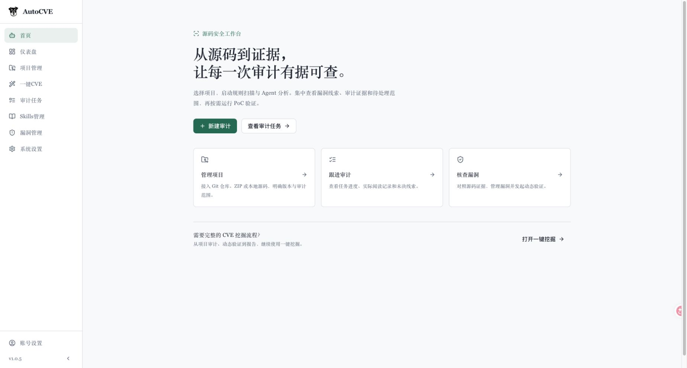

# AutoCVE · 源码审计增强版

本仓库是 [yangtt57/AutoCVE](https://github.com/yangtt57/AutoCVE)，**基于 [larlarua/AutoCVE](https://github.com/larlarua/AutoCVE) 修改**，初始基线为 [`b26025f`](https://github.com/larlarua/AutoCVE/commit/b26025f27199ba2d93145e4a08fc9015e8d846e4)。感谢原作者与贡献者提供的 Agent 审计、项目管理、一键 CVE、漏洞管理和报告能力。

本 fork 在这些能力上增加源码发现与覆盖账本、多语言入口分析、专业 Skills、独立的 Pi Docker 动态验证，并简化界面、适配 Linux / macOS 部署。原项目公布的 CVE 成果属于上游成果；本 fork 尚未测量漏洞检出率或误报率提升。

[English](README_EN.md) · [完整改动说明](docs/FORK_CHANGES.md) · [Linux / macOS 部署](docs/LINUX_DEPLOYMENT.md) · [本地开发](docs/LOCAL_DEVELOPMENT.md)



## 在原版基础上增加了什么

| 部分 | 本 fork 的新增与改进 |
| --- | --- |
| 源码发现 v2 | 独立源码分析与 Semgrep 扫描并行，首轮结果冻结后再反馈研判；保存候选历史、证据、反证和待处理工作，支持继续审计与 JSONL 导出 |
| 扫描结果保存 | 完整保存原始产物和可解析的每条 occurrence，取消前 200 条索引截断；模型按预算分批研判，未处理告警继续保留 |
| 多语言分析 | 补充 Java、Go、C#、PHP、Ruby、Rust、Kotlin、Swift、C/C++，并增强 Python、JS/TS 的符号、调用表达式和框架入口导航 |
| 入口与信任边界 | 按 Web/API、库/SDK、CLI、后台任务等场景拆分工作包，沿输入、身份、租户、对象权限和敏感操作组织分析 |
| 专业 Skills | 18 个固定版本适配包，来源于 Trail of Bits、Cloudflare、Sentry；按场景读取，记录实际使用的文件、行范围、哈希和来源 |
| 独立动态验证 | Pi Agent 在 Docker 中实际搭建目标并执行 PoC；通过专用 DinD 运行被测服务，保存 stdout/stderr、HTTP 交互、产物与判定，支持暂停/继续和重启收尾 |
| 覆盖与界面 | 区分流程进度、扫描数量和实际源码阅读；增加候选筛选、带行号的源码证据与版本历史，统一简洁的浅色界面 |
| 跨平台部署 | 统一 Linux / macOS 脚本，识别 Docker context/socket；移除固定的 Mac 网络设置，锁定依赖并补齐多语言解析、中文 PDF 和平台回归 |

框架识别与同名调用导航属于辅助线索，不能替代完整调用图或运行验证。详细边界、文件入口和第三方来源见 [改动说明](docs/FORK_CHANGES.md)。

## 安装：从本 fork 源码构建

准备 Git、Docker 和 Docker Compose **2.24+**。Linux 使用 Docker Engine；macOS 可使用 Docker Desktop 或 Colima。主应用和验证环境均运行在 Linux 容器中。独立 Pi 验证使用 privileged DinD，部署与资源要求见 [平台说明](docs/LINUX_DEPLOYMENT.md)。

### 1. 下载并配置

```bash
git clone https://github.com/yangtt57/AutoCVE.git
cd AutoCVE
cp .env.example .env
cp backend/env.example backend/.env
```

编辑配置后再启动：

| 文件 | 必须填写或确认的配置 |
| --- | --- |
| `.env` | 新数据库设置 `POSTGRES_PASSWORD`；按需调整 `WEB_PORT` 等端口。已有数据卷的密码不会因修改此文件自动更新 |
| `backend/.env` | `LLM_PROVIDER`、`LLM_API_KEY`、`LLM_MODEL`、`LLM_BASE_URL`；模型 ID 与服务商提供的一致 |
| `backend/.env` | 将 `SECRET_KEY` 改成随机值，例如运行 `openssl rand -hex 32` 生成 |

Compose 会统一配置容器内数据库、Redis、存储和 Docker 地址。真实密钥放在本地 `.env`，不要写入示例文件或提交到 Git。

### 2. 构建并启动主服务

```bash
./scripts/check-platform.sh
./scripts/compose.sh build backend frontend sandbox static-scanner
./scripts/compose.sh up -d db redis backend agent-worker one-click-cve-worker frontend
./scripts/compose.sh ps
```

后端启动时自动执行数据库迁移。首次构建需要下载依赖与扫描镜像；后续更新源码后重新构建即可。

- 网页：`http://localhost:3000`；Linux 服务器使用 `http://服务器地址:3000`。
- API 文档：`http://localhost:8000/docs`；API 默认只绑定宿主回环地址。
- 首次初始化包含管理员演示账号：`demo@example.com` / `demo123`。对外开放服务前，在账号设置中修改密码；初始化的演示数据不代表本 fork 的真实发现。

**请使用上述源码构建命令。** 仓库保留的 `docker-compose.prod*.yml` 指向上游 v1.0.5 镜像，不包含本 fork 新增功能。

### 3. 启用独立 Pi 动态验证（可选）

先在 `backend/.env` 设置：

```dotenv
VERIFICATION_AGENT_ENABLED=true
# 使用实际的 provider 和 model ID，与 LLM_PROVIDER / LLM_MODEL 保持一致：
VERIFICATION_AGENT_MODEL_PROVIDER=your-provider
VERIFICATION_AGENT_MODEL_ID=your-model-id
VERIFICATION_AGENT_MAX_CONCURRENCY=1
```

以上 `your-*` 是占位符。默认启动脚本从 `backend/.env` 的 `LLM_*` 读取验证容器的模型配置，后端 `VERIFICATION_AGENT_MODEL_*` 必须与之对应；如使用独立模型，可通过 `VERIFIER_*` 覆盖，见 [动态验证说明](docs/DYNAMIC_VERIFICATION.md)。当前容器适配 OpenAI Chat Completions 兼容协议。

```bash
./scripts/verify-stack.sh up -d --build
# 修改 backend/.env 后重建服务容器以加载新配置：
./scripts/compose.sh up -d backend agent-worker one-click-cve-worker
./scripts/verify-stack.sh ps
# 可选：真实调用一次模型，会产生 API 用量
./scripts/verify-stack.sh smoke
```

Pi 会在专用 Docker daemon 中真实构建、启动项目并尝试复现，结果需要原始证据支撑。Pi 容器不挂载宿主 Docker socket，但 privileged DinD 不等于虚拟机隔离；具体执行边界见 [动态验证说明](docs/DYNAMIC_VERIFICATION.md)。

## 怎么使用

1. **配置模型**：确认 `backend/.env` 的模型配置可用，也可在应用的模型配置入口设置主审计模型。独立 Pi 使用上述服务端环境配置。
2. **导入项目**：在“项目”添加 Git 仓库、上传 ZIP，或使用已有本地目录。Compose 部署时，把本地源码放在仓库 `projects/` 下，界面填写 `/workspace/projects/项目目录`。
3. **创建源码审计**：进入“审计任务 → 新建审计”，选择项目、版本和分析预设。当前创建窗口默认开启“使用源码发现与覆盖账本”，根据入口与场景自动选择 Skills。
4. **查看证据与覆盖**：进入任务详情的“候选与覆盖”，查看静态支持、未决、排除项和原始工具告警。打开源码证据核对真实行号；存在可调度的剩余工作时可继续审计。
5. **使用原有 CVE 流程**：通过“一键 CVE”或关闭源码发现开关进入原有审计流程。源码发现 v2 的候选保存在独立账本中，不会自动变成已验证漏洞或 CVE 申报材料。
6. **执行真实动态验证**：在“漏洞管理”对已有漏洞记录点击“动态验证”，查看环境、复现步骤、原始输出与判定，按需暂停/继续或导出验证报告。

`confirmed` 表示本次验证有运行证据；`refuted`、`inconclusive`、`unverifiable` 分别保留推翻理由、未决条件或无法搭建环境的原因。静态结论和动态判定分别展示，验证结果目前不会自动改写既有报告状态或 CVSS。

## 日常维护与开发

```bash
./scripts/compose.sh logs --tail 100 backend agent-worker
./scripts/verify-stack.sh logs --tail 100 pi-verifier verifier-dind
./scripts/compose.sh stop
./scripts/verify-stack.sh stop
```

停止命令保留数据卷。升级前备份数据库、上传卷、`projects/`、技能和报告模板；不要复制另一台机器的 `.venv` 或 `node_modules`。代理、DNS、rootless Docker、目录挂载和故障排查见 [Linux / macOS 部署](docs/LINUX_DEPLOYMENT.md)。

本机热重载开发使用 Python 3.12、uv、Node.js 22.19+ 和 npm，安装依赖后运行 `./start.sh`，访问 `http://localhost:5173`；停止用 `./stop.sh`。完整准备步骤与 Pango 等系统依赖见 [本地开发](docs/LOCAL_DEVELOPMENT.md)。

## 文档

| 文档 | 内容 |
| --- | --- |
| [本 fork 改动清单](docs/FORK_CHANGES.md) | 上游归属、功能增量、实现入口、验证范围和未实现部分 |
| [源码发现 v2](docs/DISCOVERY_V2.md) | 候选账本、覆盖、恢复、导出、配置和 API |
| [检测与体验改进](docs/DETECTION_AND_UX.md) | 多语言、入口、信任边界、覆盖与界面 |
| [Skills 接入](docs/SKILLS_INTEGRATION.md) | 18 个适配包、来源、许可证、读取边界与升级 |
| [独立动态验证](docs/DYNAMIC_VERIFICATION.md) | Pi、DinD、真实 PoC、暂停/继续和证据契约 |
| [Linux / macOS 部署](docs/LINUX_DEPLOYMENT.md) | 源码构建、平台差异、网络、存储、迁移与预检 |
| [本地开发](docs/LOCAL_DEVELOPMENT.md) | 环境准备、启动、日志和常用检查 |
| [上游功能手册](docs/USER_GUIDE.md) | 原有模型、项目、一键 CVE、漏洞和工作流功能；部署以本 README 为准 |

## 来源与许可

基础项目由 [larlarua/AutoCVE](https://github.com/larlarua/AutoCVE) 开发；本仓库保留 Git 历史与 [AGPL-3.0 许可证](LICENSE)。上游说明其早期工程架构参考了 [DeepAudit](https://github.com/lintsinghua/DeepAudit)，这里一并保留致谢。

新增 Skills 的第三方材料分别保留 Trail of Bits（CC-BY-SA-4.0）、Cloudflare（MIT）、Sentry（Apache-2.0，部分 OWASP 参考为 CC-BY-SA-4.0）的来源、许可证和修改说明；详见各适配包的 `NOTICE.md`、[固定来源清单](skills_sources_manifest.json) 与 [归档说明](skill_sources/README.md)。这些材料的许可不替换项目根许可证。

本 fork 的问题和改进建议请提交到 [yangtt57/AutoCVE Issues](https://github.com/yangtt57/AutoCVE/issues)。沿用上游的用途要求：仅用于已获授权的安全研究、代码审计和学习，漏洞披露遵循目标项目的安全政策。
